# Comunidad Connect, live site: first walk report

Live site `https://www.comunidadconnect.org/`, logged out, read-only. Walked 2026-10-15 (the run folder keeps the name the goal gave it, `2026-10-14-live`). Five Walkers, seven walks, plus three reruns after a server fix, and one Inspection. Nothing was submitted, no account was made, and no payment was started. This report was written by hand: `msw report` does not exist yet.

## Did each Walker reach their goal?

| Walker | Viewport | Language | Reached goal | How it ended |
|---|---|---|---|---|
| Marisol, first-time learner | phone | English | **Yes** | Done in 4 steps: what they do and where (home page), and a way to take part without money (Travel card on Get Involved) |
| Marisol, first-time learner | phone | Spanish | **Yes** (pass 2) | Done in 6 steps. In pass 1 she never got past the cookie panel: the walk server refused every tap (see "What got in the way", item 1) |
| Teresa, existing monthly donor | phone | English | **No** | Ran away (out of patience) in pass 2. No way to change a monthly gift except a general contact page; could not open any news item. Pass 1: stuck, same result |
| Ruth, slightly motivated giver | desktop | English | **Partly** (pass 2) | Chose a one-time $50 gift with no account and pressed Continue to Payment, where read-only mode stops (the checkout request was blocked, as designed). She had to undo a default Monthly choice and two pre-ticked boxes on the way. Pass 1: no tap accepted |
| Daniel, trip invitee | desktop | English | **No** | Ran away after 4 pages: no price, length, dates, group size or safety information anywhere |
| Daniel, trip invitee | desktop | Spanish | **No** | Ran away: same gap; the only route to trip details is a portal for invited travelers |
| Ana, partner seeker | desktop | English | **Yes** | Done in 13 steps: groups are welcome, where they work, and a contact form with a Partnership Opportunities topic. No named person |

The Inspection of the guide compiled from Ana's walk ended `## STATUS: PASS` on its second attempt (the first failed on a walk-server problem, not the guide). See "The Inspection" below.

## Top 10 findings, by severity

Severity is 0 to 4: 2 minor, 3 major (costs the visitor their goal or nearly), 4 catastrophe. No finding reached 4: no journey was walked on both phone and desktop, so the "cannot be completed on any viewport" floor was never tested.

1. **[3] No price, trip length, dates, group size or safety information for the cultural trips.** Daniel (desktop, English and Spanish). Screen: `/en/our-work/programs/cultural-connections`, then `/en/about/partners`; in Spanish `/es-LA/trips`. **What happened:** he read the whole Cultural Connections page, including its six-question FAQ. He learned where the trips go and what is included (projects, homestays, meals, expert-led sessions). There was no cost, length, sample dates, group size, or anything on safety, insurance or supervision. In Spanish, the Viajes page says details are in a "Portal de Viajes" for people already invited. **Expected:** a rough price range, typical length, sample dates and a safety and lodging summary on the public page, enough for a one-paragraph proposal to a dean.
   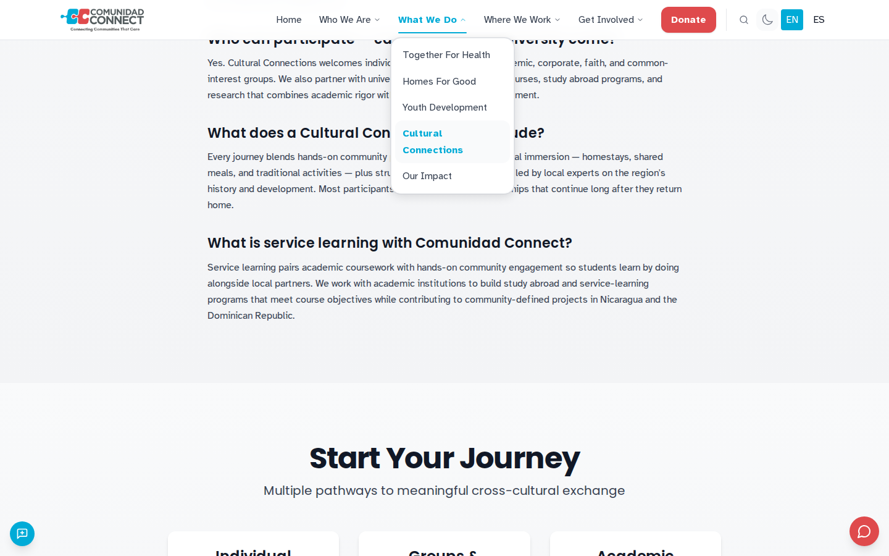
2. **[3] A monthly donor has no way to change their gift.** Teresa (phone). Screen: `/en/get-involved/donate`, then `/en/contact`. **What happened:** the Donate page only starts a new gift. Nothing says "already giving monthly? change it here". There is no donor sign-in and no manage-gift link. The Contact page lists a general email and phone and talks only about volunteering, partnering and programs. She feared that picking an amount would start a second gift. **Expected:** a "change or pause my monthly gift" link (for example a payment-provider customer portal), or at least one line saying whom to write to.
   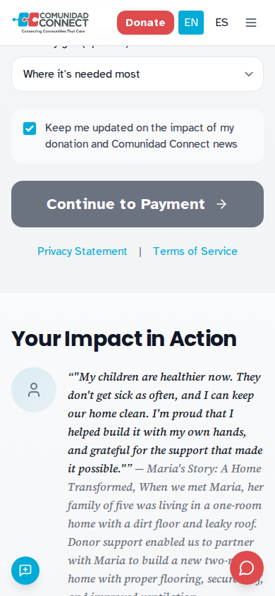
3. **[3] The donation form starts on Monthly.** Ruth (desktop). Screen: `/en/get-involved/donate`. **What happened:** "Monthly" is pre-selected as a bright red button, and every amount reads "/mo". "One-Time" sits beside it as plain text that does not look like a button. A visitor who wants to give once can sign up for monthly giving without noticing. **Expected:** no frequency chosen until the visitor chooses, or One-Time first, with both options styled as equal buttons.
   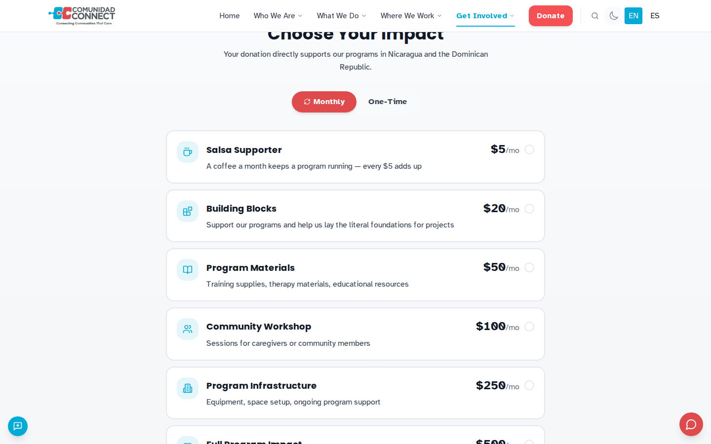
4. **[3] Two boxes are ticked for the donor: a fee top-up and a newsletter sign-up.** Ruth (desktop). Screen: `/en/get-involved/donate`. **What happened:** "Cover transaction fees… Add $1.44" was already ticked, so a $50 gift became $51.44. "Keep me updated on … Comunidad Connect news" was also already ticked. The $1.44 line is small grey text. The final summary never says "one-time". **Expected:** both boxes empty until the donor ticks them, and the summary should say how often the gift repeats.
   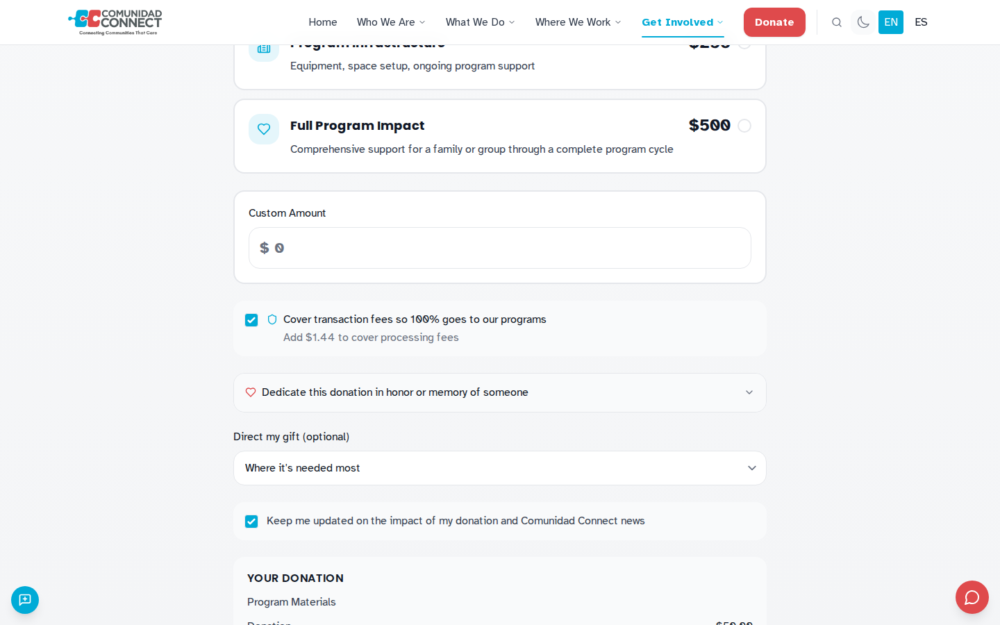
5. **[3] The home page story strip rotates on its own, cannot be paused, and ignores the reduced-motion setting.** Every Walker; worst for Teresa (phone). Screen: `/en` and `/es-LA`. **What happened:** the strip under the hero switches every few seconds between five items (website feedback, July 2026 Bulletin, two stories, a featured story). On a phone the titles are cut to a few letters ("Reyna S…"). Teresa tried four times to open the July 2026 Bulletin, and each time it slid away first. A browser set to `prefers-reduced-motion: reduce` gets the same rotation (checked separately: `harness/probe-reduced-motion.out`). **Expected:** a strip that stops when touched or hovered, has a visible pause control and respects reduced motion (WCAG 2.2.2), or a plain list of recent news with full titles. *Caveat: part of this was felt through the walk server's own trouble with moving pages (item 1 of "What got in the way"). The rotation, the truncation and the lack of a pause are on the site.*
   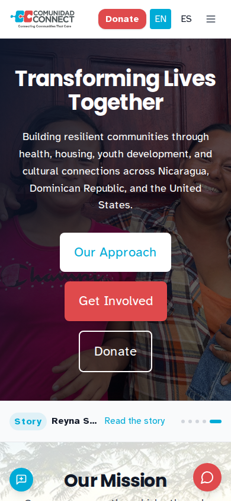
6. **[3] There is no News or Stories item in the menu.** Teresa (phone). Screen: `/en` (menu open). **What happened:** the menu has Who We Are, What We Do, Where We Work and Get Involved (Contact Us, Trips, Collective Narrative, Store). Nothing is called News, Stories or Updates. The only news she saw was the rotating strip. She ran out of patience without reading one dated news item. **Expected:** a "News & Stories" menu item leading to a dated list, newest first.
   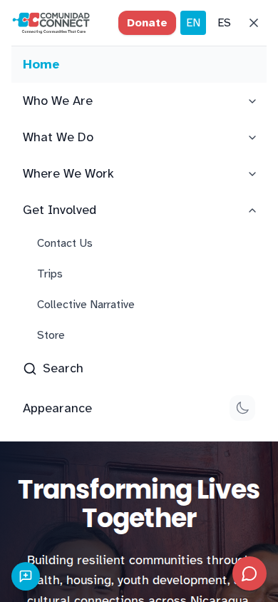
7. **[3] "Partnership Information" leads to a page about existing partners, not how to become one.** Daniel (desktop). Screen: Cultural Connections, Academic Partners card, then `/en/about/partners`. **What happened:** the button opened "Our Partners" under Who We Are. That page shows partner counts (20+ academic partners) but nothing on how a university sets up a program or whom to contact. **Expected:** a page or form for new academic partners: what a program looks like, the steps, and a named contact.
   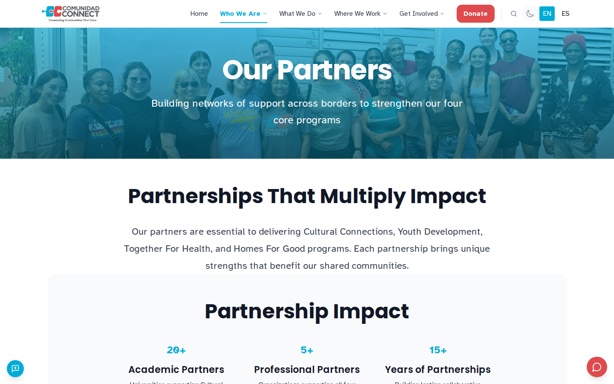
8. **[3] Low text contrast on every page walked.** Instrument (axe-core, "serious") on all 20 page addresses visited, 127 times. The Walkers felt it too: Daniel could barely read the university testimonial (white italic text on pale blue), in English and Spanish. Screen: `/en/our-work/programs/cultural-connections`. **Expected:** text that meets WCAG AA contrast (4.5:1 for body text).
   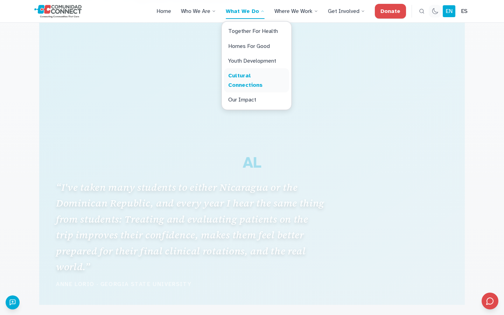
9. **[2] Spanish pages switch to English.** Marisol (phone, Spanish), Daniel (desktop, Spanish). Screen: `/es-LA` and `/es-LA/our-work/programs/cultural-connections`. **What happened:** the site opened in Spanish on its own (good), but on the Spanish home page the story strip titles stay in English ("How We're Born", "July 2026 Bulletin", "Where We're Born"), next to "Leer la historia". So do the control labels ("Send feedback", "Chat with Carmen", "Go to item…") and the logo tagline. The testimonial on the Spanish trip page is entirely in English. **Expected:** Spanish throughout the Spanish site, or no untranslated item shown there.
   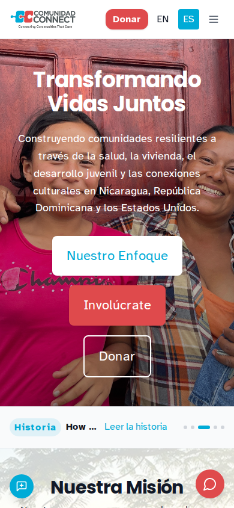
10. **[2] Photos missing where visitors most want to see them.** Ana and Daniel (desktop). Screen: `/en/trips` ("What Our Trips Look Like") and the Cultural Connections testimonials. **What happened:** all three trip cards showed a broken image with its alt text. The testimonials had screen-tall pale boxes holding only initials ("AL", "T"). The site's own console reported "Image failed to load" for several hero and card images (donate-hero, impact-bg, nicaragua, dominican-republic, usa, locations-hero). **Expected:** real photos of trips and people. *Caveat: these images come from a cloud storage host, and the walk ran behind the box's network proxy. Confirm from an ordinary connection before acting.*
   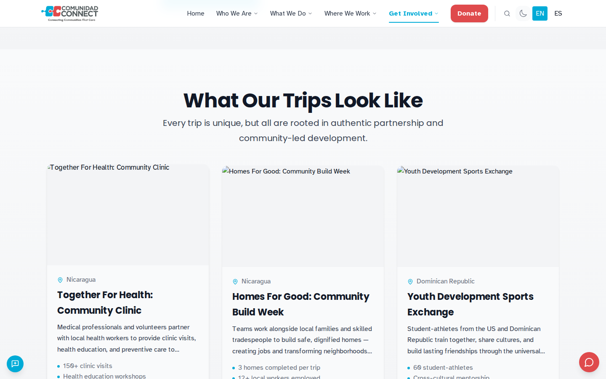

## More findings

Each line gives the Walker, the screen, the severity and the evidence screenshot.

- **[2] Menus and dropdowns stay open after you move on**, covering headings and cards. This happened to the What We Do, Get Involved and Where We Work menus, and to the contact form's topic list. Ana, Daniel and Teresa. Screen: `/en/our-work/programs/cultural-connections`. 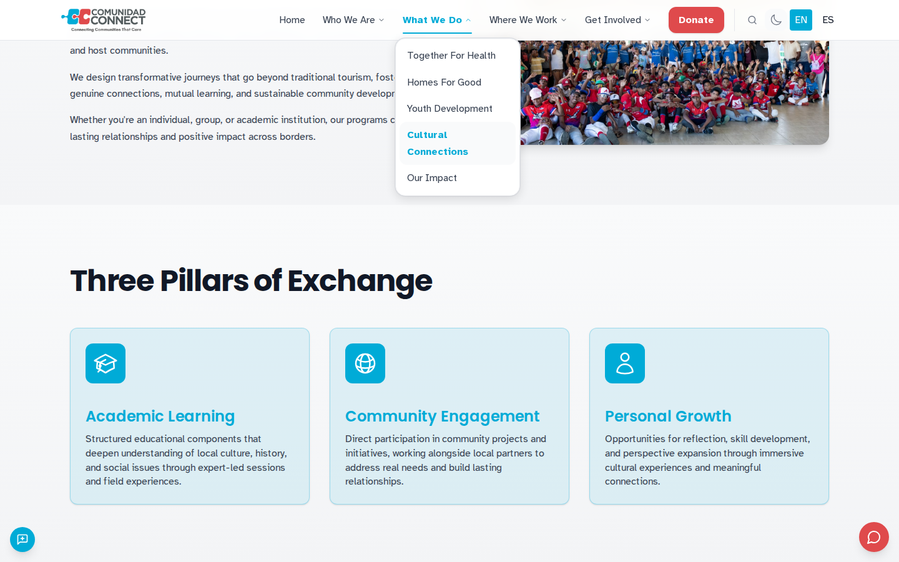
- **[2] The FAQ says to "reach out through our contact page" but does not link to it**, and the top menu has no Contact item. Daniel. Screen: `/en/our-work/programs/cultural-connections` (FAQ), same screenshot as finding 1.
- **[2] No named person for partnerships or group trips.** There is one general email, phone and form, with a promised 24–48 hour reply. Ana. Screen: `/en/contact`. 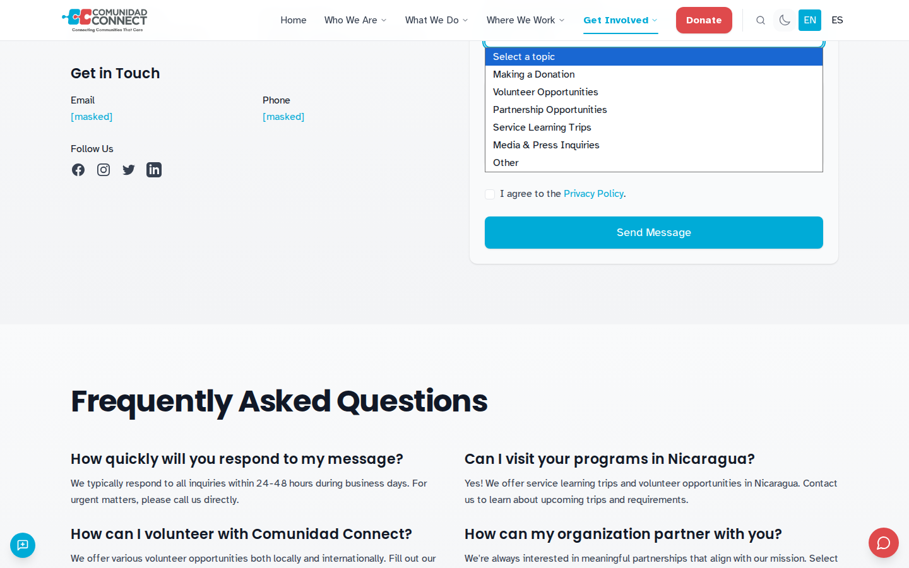
- **[2] "Ser voluntario" is promised, but there is no volunteer card.** The Involúcrate intro lists donar, ser voluntario, asociarte, abogar, but the cards are only Viajar, Donar, Asociarse and Compartir Historias. Marisol (Spanish). Screen: `/es-LA/get-involved`. 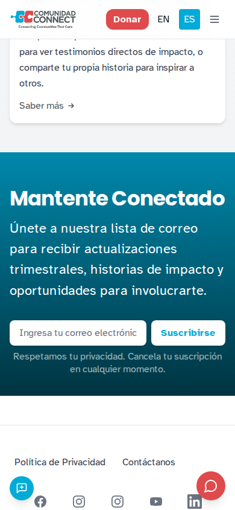
- **[2] Testimonial cards show huge blank boxes with a single letter.** Daniel. Screen: `/en/our-work/programs/cultural-connections`. 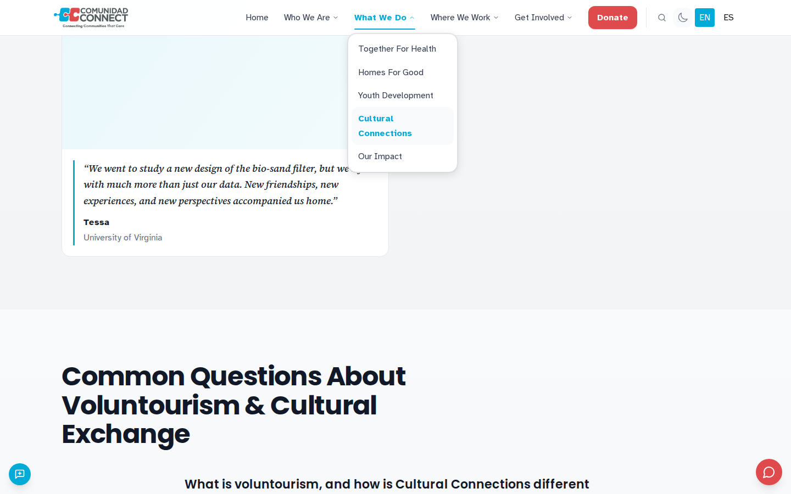
- **[1–2] The cookie panel covers half the phone screen on arrival**, including Get Involved. The panel itself is clear, in both languages, with a plain "Reject all". Marisol. Screen: `/en`. 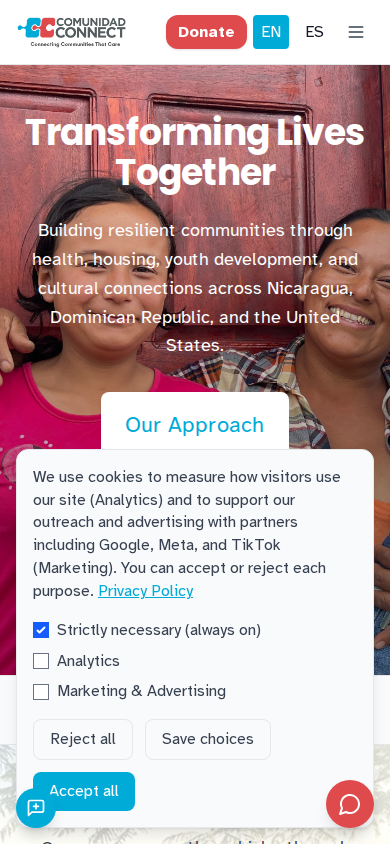
- **[1] Vague words above the fold.** "Our programs are the vehicles through which our purpose and approach come to life" and "Community Building × Social Impact = Resilience". Ruth and Marisol. The plain story (Maria's family home) sits at the bottom of the Donate page, below the payment button. Screen: `/en`, `/en/get-involved/donate`. 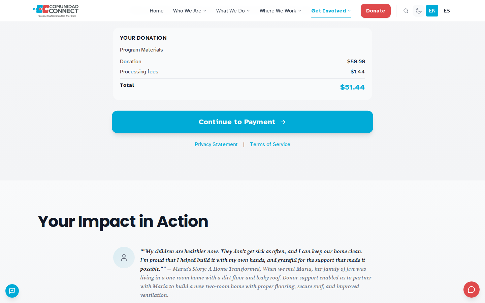
- **[2] Slow or unstable pages** (instrument: load over 4 s or layout shift over 0.25) on 12 page addresses, including the home page in both languages. *Measured through the box's proxy; treat as a lead, not a measurement.*
- **What worked:** the home page says plainly what the organization does and where (health, housing, youth development and cultural connections in Nicaragua, the Dominican Republic and the United States). No Walker was asked for an email or an account before learning anything. The site opens in Spanish for a Spanish browser. Get Involved → Travel → Trips → Get in Touch is a clear and honest route for groups. Screen: `/en/get-involved`. 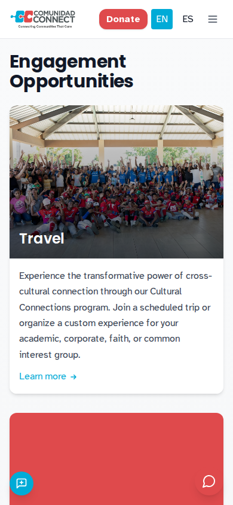

## The Inspection

The spec's Inspection is a different agent with no shared context, given only the guide, web blocked, following each step literally. It **could run, with stand-ins** for three things plan A did not build:

- **No `msw-guide` skill.** The guide was compiled by hand from Ana's walk (the clearest successful walk): `inspection/guide-partner-seeker.md`, seven steps.
- **No `msw-inspect` skill.** The instructions are a stand-in: `harness/inspect-prompt.md`.
- **No inspection mode in the server.** The server needs a Walker dossier and a journey, and demands ratings and the four Wharton answers on every act. The Inspector used a stand-in dossier (`walkers/inspector.yaml`, patience 50) and journey (`journeys/inspector-partner-seeker-guide.yaml`).

The Inspector was a separate `claude -p` session on a different model (Claude Sonnet 5.5; the Walkers ran on Claude Opus 5.5). It had no built-in tools and no web tools. It had only the five msw tools and the guide text. It shared no context with the Walkers or with this report.

- **Attempt 1:** `## STATUS: FAIL at step 3`. The home page has two "Get Involved" links (top menu and hero), and the first version of the server fix only recognized a control that appeared once. The Inspector correctly blamed the tool, not the guide. Evidence: `inspection/attempt-1/`.
- **Attempt 2**, after the fix handled same-named controls: **`## STATUS: PASS`**. All seven steps matched by meaning. It proposed optional clarifications only: "about two screens" of scrolling, the masked email and phone, and the full list of communities. The proposed diff is in `inspection/attempt-2/guide-partner-seeker-result.md`. It is not applied: an edited guide must be inspected again.

Only Ana's journey has a guide. Marisol's English and Spanish walks also succeeded and could be compiled and inspected next. The Minister's Walk (a person walking the inspected guide) has not happened. Per the spec, nothing here is certified until it has.

## Instrument summary

The server records console errors, failed requests, axe violations and vitals on every page. They are never shown to the Walker. Its severity floors made every console error a 3. Read with care: most console errors in this run were caused by the test setup, not the site.

| Source | Count | Whose problem |
|---|---|---|
| Color contrast, axe "serious" | 127 records, every page walked | **Site** (finding 8) |
| "Image failed to load" (site's own console messages) | 32 | **Probably the site**; confirm off the box (finding 10) |
| `net::ERR_TUNNEL_CONNECTION_FAILED` | 148 | **Box**: the egress proxy refuses some third-party hosts (`www.google.com` and others) |
| Firestore "Could not reach backend" | 10 | **Read-only mode**: the server blocks the POST channel the site uses to read live data |
| Chat (Carmen) "Failed to fetch" | 1 | **Read-only mode**: the chat request was blocked as `would-submit`, as designed |
| Slow or unstable page | 15 | Unclear: measured through the proxy |

No HTTP 4xx or 5xx response from the site itself was recorded.

## Run health

| Walk | Pass | Steps | Refused | Server re-looks (drift) | Walker findings (reproduced) | Verified | Alive |
|---|---|---|---|---|---|---|---|
| Marisol, phone, English | 1 | 4 | 9 | — | 3 (1) | true | false |
| Marisol, phone, Spanish | 1 | 0 | 7 | — | 3 (2) | true | false |
| Marisol, phone, Spanish | 2 | 6 | 0 | 2 | 3 (1) | true | false |
| Teresa, phone | 1 | 16 | 8 | — | 4 (0) | true | false |
| Teresa, phone | 2 | 11 | 3 | 3 | 4 (0) | true | false |
| Ruth, desktop | 1 | 0 | 9 | — | 1 (0) | true | false |
| Ruth, desktop | 2 | 11 | 0 | 2 | 2 (2) | true | false |
| Daniel, desktop, English | 1 | 13 | 5 | — | 7 (3) | true | false |
| Daniel, desktop, Spanish | 1 | 10 | 1 | — | 2 (2) | true | false |
| Ana, desktop | 1 | 13 | 5 | — | 5 (0) | true | false |
| Inspector, attempt 1 | — | 1 | 4 | 1 | 1 (0) | true | false |
| Inspector, attempt 2 | — | 12 | 0 | 2 | 0 | true | false |

- **Verified** (every event's signature and chain checks out): **true for every walk.**
- **Alive** (the Dead Parrot check): **false for every walk**, for only two reasons, both caused by the rotating strip. Each strip position is a new page state, so some states have one screenshot instead of two ("page … has 1 screenshot"). The first of the two arrival looks can catch a state that is never instrumented ("page … has no instrument record"). No walk failed any other check: every act followed a look of the same page, every finding cites this walk's events, and no acts were too close together. The failures are listed in each walk's `seal.json`.
- **Reproduced:** 11 of 35 Walker findings replayed to the same page state. Replays on pages with the rotating strip rarely land on the same state.
- **"We are all individuals":** not run (`msw individuals` does not exist). By eye, no two Walkers took the same path past their second step.
- **Read-only held:** two `would-submit` blocks, both scripted requests: the chat message (`/en/api/carmen/sessions`) and the checkout (`/en/api/payments/create-checkout`). 377 background writes were blocked (analytics, Stripe telemetry, Firestore). No form reached the site.

## What got in the way in MSW (for plan B)

1. **Moving pages break "act on what you saw".** The page state hashes the visible text, so a rotating strip changes the state every few seconds. Every act the Walker chose was refused as "the page changed; look again". In pass 1, Ruth and Marisol (Spanish) got no act accepted at all. The first Inspection failed the same way. **Fixed narrowly in this branch** (`server/src/walk/session.ts`, tests in `server/tests/drift.test.ts`). If the address is unchanged and the chosen control is still there, with the same role and full name and the same number of same-named controls, the server takes and logs a fresh look itself, then acts on that control. The act records `drift_from`. Anything else is still refused. Pass 2 and Inspection attempt 2 ran on this build. It changes a rule in spec 5.3 and needs plan B review: see decision D-1.
2. **The Dead Parrot check fails every walk on a page with a carousel** ("1 screenshot" and "no instrument record" per state). A real faked walk would not stand out. "Page" needs a definition that survives content that moves by itself.
3. **Reproduction rarely works on moving pages.** Replays compare exact page states.
4. **Read-only blocks reads that use POST.** Firestore's listen channel, and possibly the site's live content, never loaded. The resulting console errors became severity-3 findings blamed on the site. Read-only needs a way to allow known read-over-POST endpoints, or to label these errors as caused by the walk.
5. **The instrument pass cannot tell the box's network from the site.** 148 proxy failures became severity-3 "console error" findings. Requests refused by the environment should be labeled and kept out of the floors.
6. **Over-masking.** ISO timestamps in console text are masked as phone numbers (`[masked]T13:33:25`), and so are analytics query values. That is harmless for privacy but makes records harder to read.
7. **Read-only cannot show the payment step.** The giver's success condition ("reaches the step where card details would be entered") cannot be met when the payment page sits behind a POST. The journey format needs "the would-submit block of the checkout counts as reaching it", or the server should say so to the Walker.
8. **No skills yet.** `msw-walk`, `msw-guide` and `msw-inspect` do not exist. This run used stand-ins: `harness/walk-prompt.md`, the hand-compiled guide and `harness/inspect-prompt.md`. `msw-dossier` and `msw-journeys` also do not exist. The dossiers and journeys were written by hand in the first attempt at this walk.
9. **No inspection mode.** The Inspector needs a fake dossier and journey, and must give ratings and Wharton answers it does not have. Patience charges mean nothing for it.
10. **No reports tooling.** `msw report`, `msw individuals` and `msw compare` do not exist, and nothing calls `journeyFloor`. This report and its HTML were made by hand. `harness/md2html.py` turns this file into `REPORT.html`.
11. **A Claude Code session cannot pick up a newly registered MCP server.** The server was registered (`claude mcp add -s local msw …`, connected). The walks themselves ran as one `claude -p` session per Walker, with only the msw tools (`harness/walk.sh`). That also kept the Walkers apart from each other and from the report writer.
12. **Evidence is large.** One run left about 400 MB: 133 MB of PNG screenshots, about 220 MB of replays and 75 MB of session logs. Only the text evidence and the cited screenshots are committed; see decision D-2.
13. **The quit text confuses Walkers.** "Findings: 28" counts instrument findings too. Every Walker asked why the number was larger than its notes. The quit result should split Walker and instrument counts.
14. **Box limits.** The box's guard hook refuses any command that names the site's storage bucket (its name contains "prod"), so the missing images could not be checked from the box. The box runs Node 20.20.2, and the README asks for Node 22. Build, typecheck and all tests pass on 20 anyway.
15. **Carried over from the first attempt (walk-1, unverified here):** `start_walk` succeeds when the start page fails to load, axe then checks Chrome's error page, and a failed start uses up the walk folder.

## How this was run

- Server built and tested per `server/README.md`: Playwright 1.63.0 with the box's Chromium 1243 (`PLAYWRIGHT_BROWSERS_PATH=/ms-playwright`).
- Run files: `run.json` (pass 1), `pass-2/run.json`, `inspection/attempt-1/run.json`, `inspection/attempt-2/run.json`. Attempt 1's folder was moved under `attempt-1/` after it ran, so its recorded `out_dir` is the parent `inspection/`.
- Walkers: `../walkers/*.yaml`. Journeys: `../journeys/*.yaml`. Each Walker's first-person narration is in `walks/<walk>.md` and `pass-2/walks/<walk>.md`.
- Pass 1 ran on the plan A server as merged. Pass 2 and the Inspection ran on this branch's server, with the drift rule (item 1 above). Pass 1 results are kept, not replaced.
- After the first walk, one line was added to the walk instructions: a "page changed" refusal is free; look and try again.

### Evidence kept out of git

`screens/`, `replays/` and `harness-logs/` are ignored (`.gitignore` in this folder). The screenshots this report and the guide cite are committed. Everything else stays in the box clone's working tree until decision D-2.

## Decisions for Jimmy

```yaml decision
id: D-1
question: Should the walk server keep the drift rule that lets an act go through when only self-moving content changed?
options:
  - keep it and review it in plan B — walks of carousel pages work now; the rule is narrow and tested
  - revert it and redesign in plan B — the spec's rule stays exact; carousel pages cannot be walked meanwhile
  - replace it with a state hash that ignores self-moving regions — closer to the spec's intent; more work and needs region detection
recommended: keep it and review it in plan B
rationale: [Likely] Without it, three of seven pass-1 walks and the first Inspection produced nothing usable; with it, every rerun worked and the other safety refusals are unchanged.
evidence:
  - server/src/walk/session.ts
  - server/tests/drift.test.ts
  - walks/comunidad-connect/2026-10-14-live/REPORT.md
disposition: none
private: false
```

```yaml decision
id: D-2
question: Where should a run's raw evidence (full screenshots, replays, session logs; about 400 MB here) be kept?
options:
  - commit only text evidence and cited screenshots — small repo; raw files live elsewhere
  - commit everything to the public repo — complete evidence in one place; the repo grows by hundreds of MB per run
  - store raw files as a release asset or in Git LFS — complete and out of the history; needs setup on the host
recommended: commit only text evidence and cited screenshots
rationale: [Likely] The signed events, findings and seals carry the audit trail; screenshots matter mostly where a finding cites them, and a public repo should not grow by 400 MB per walk.
evidence:
  - walks/comunidad-connect/2026-10-14-live/.gitignore
  - walks/comunidad-connect/2026-10-14-live/REPORT.md
disposition: none
private: false
```

```yaml decision
id: D-3
question: What happens next with this report before Comunidad Connect sees it?
options:
  - Minister's Walk first, then share as the before — the spec certifies nothing no person has walked
  - share it with CC now as a draft before — faster feedback; uncertified, with tool caveats
  - rerun after plan B fixes, then share — cleaner run health; delays the before by a plan
recommended: Minister's Walk first, then share as the before
rationale: [Likely] The findings are concrete and evidenced, but the spec requires a human walk before certification, and two findings carry network caveats a person can settle quickly.
evidence:
  - docs/superpowers/specs/2026-10-11-ministry-of-silly-walks-design.md
  - walks/comunidad-connect/2026-10-14-live/inspection/guide-partner-seeker.md
disposition: none
private: false
```
