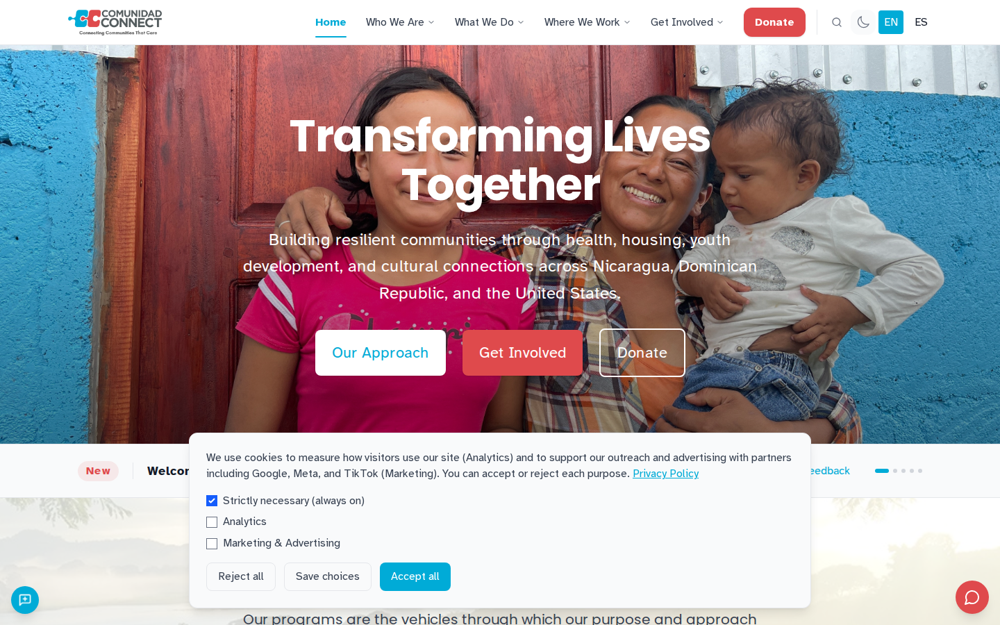
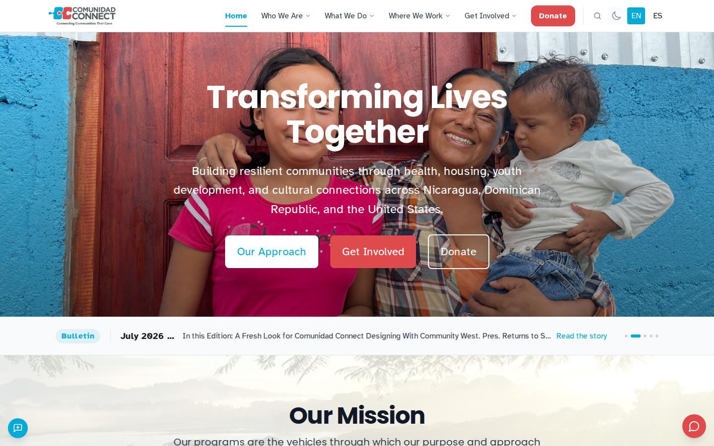
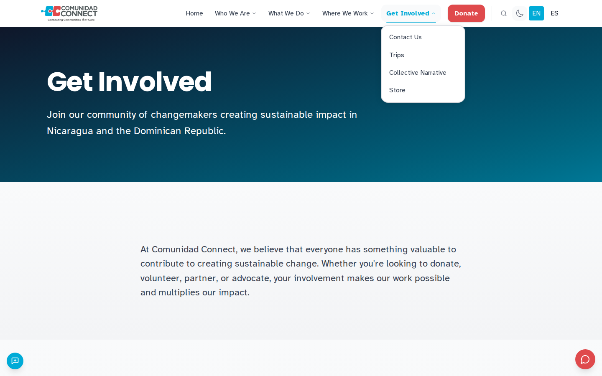
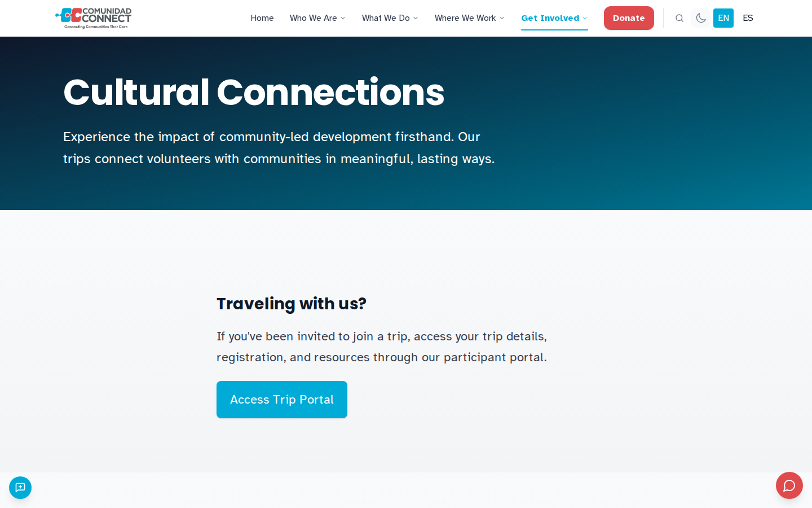
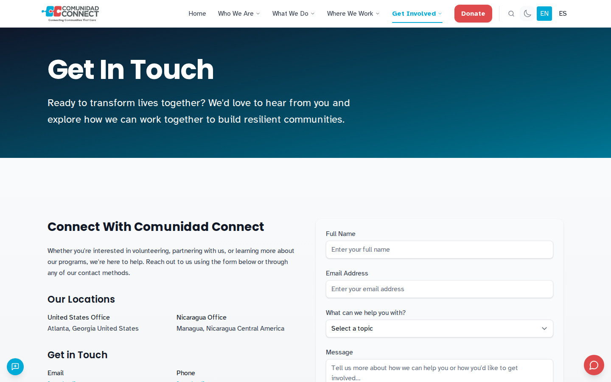
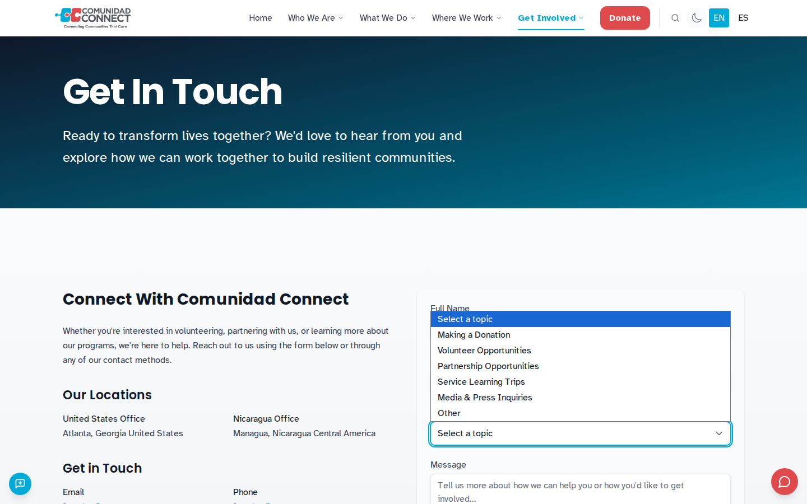
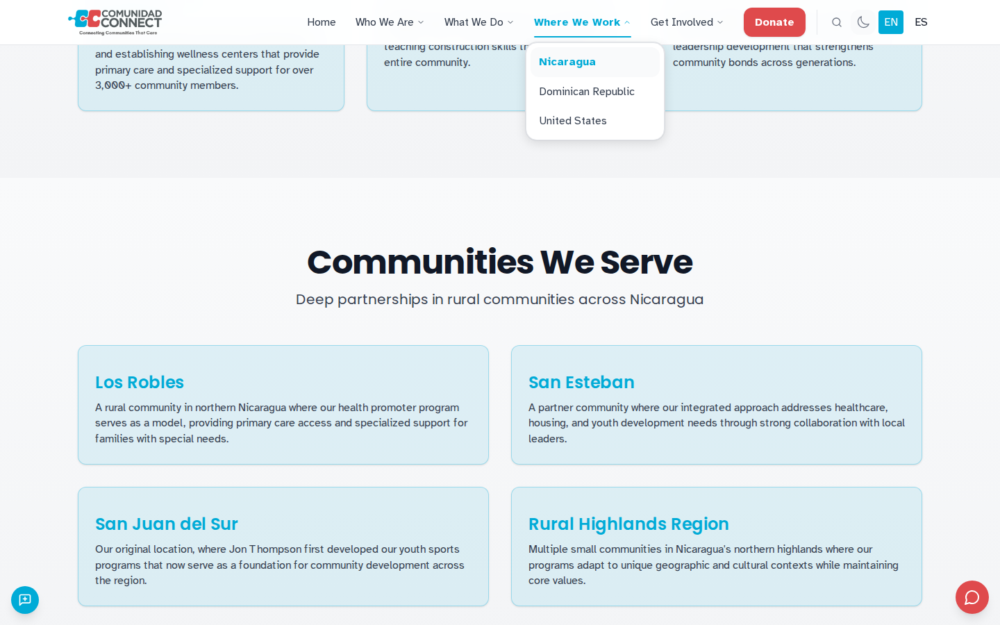

# Guide: find out whether Comunidad Connect takes outside groups, and how to ask about a partnership

*Compiled by hand from Ana's walk (partner-seeker-partner, desktop, en-US, pass 1). The msw-guide skill does not exist yet. The Ministry regrets the inconvenience and has filed it under "plan B".*

You need a computer with a wide screen. You do not need an account. Do not send any form.

1. Open https://www.comunidadconnect.org/.
   **Expected:** the home page, headed "Transforming Lives Together", with a cookie panel over the lower part of the page.
   
2. In the cookie panel, press **Reject all**.
   **Expected:** the cookie panel closes and the whole home page is visible.
   
3. In the top menu, press **Get Involved**.
   **Expected:** the Get Involved page, which says you can donate, volunteer, partner or advocate.
   
4. Scroll down to **Engagement Opportunities** and press the **Travel** card.
   **Expected:** the Trips page about the Cultural Connections program. It says trips can be organized for academic, corporate, faith or common-interest groups.
   
5. Scroll down to **Interested in bringing your group?** and press **Get in Touch**.
   **Expected:** the contact page, with offices in Atlanta and Managua, an email address, a phone number and a contact form.
   
6. Open the form's topic list, **What can we help you with?**
   **Expected:** the list includes **Partnership Opportunities**. Do not choose it and do not send the form.
   
7. In the top menu, press **Where We Work**, then **Nicaragua**, and scroll down to **Communities We Serve**.
   **Expected:** the Nicaragua page names the communities where the organization works, such as Los Robles and San Juan del Sur.
   

*If you have reached step 7 without being asked for an email address, you have achieved something many visitors to many websites never do. The Ministry salutes you.*
