# WorkGraph AI on demo accounts: team-member walk 2, 2026-10-25

Build: WorkGraph AI `dev` at `e073d441` (a plain copy supplied by the host), built with `next build` and run locally at `http://localhost:3000` against a throwaway embedded Postgres. It was seeded only with the five demo profiles: Acme Industrial Services, Northwind Logistics, Riverpoint Software, Corvane Telematics and Meridian Financial Technologies. The Walker signed in as the demo internal user `demo@workgraph.local`. It was read-only: the walk server stopped every POST, PUT, PATCH and DELETE, and no Walker pressed Send, Save, Submit or Delete.

**Nothing is masked.** Every screenshot shows only demo data (`SHOTS-CHECK.md`). The org check passed before any Walker started: five organizations, all demo (`ORG-CHECK.txt`).

## Did each Walker reach their goal?

| Walker | Journey | Device | Reached? | Where they got stuck |
|---|---|---|---|---|
| Marcus, WorkGraph AI engagement lead (team member) | **New:** open a demo engagement, then by clicking only reach the star map, the transcripts, a role's evolution timeline and a project's workflows (the PR #387 sidebar check) | desktop | **No** | The new **Work Evolution** sidebar group is there: Star map, Workflows, Company timeline, Transcripts, one click each. But it sits below the fold, and every page behind it was empty for every demo engagement. Star map: "No synthetic project to map yet". Transcripts: none in any project. Workflows: "0 named workflows", a builder. He found no role evolution timeline from Roles and ran out of patience after 15 steps |
| Marcus | Work map (walk 1's journey): star map, transcripts, a project's process flows and evolution timeline | desktop | **Partly** | Reached every page by clicking. Only the evolution timeline had anything in it: Company timeline worked. The star map, transcripts and workflows were empty, and the one interview he opened as a stand-in transcript had 0 answers. 16 steps |
| Marcus | People (walk 1's journey): roles, a role's evolution timeline, survey sends, Current-State Readout | desktop | **Partly** | Roles, Survey sends and the Readout are one click each. As in walk 1, he never saw the role page's **Evolution** tab, because a role opened from the Roles list lands scrolled past the tab row. He reached a role's evolution timeline only through Company timeline → Role replay. The Readout still has no readiness label, and its numbers differ from the Roles page. 17 steps |

**The PR #387 check:** the sidebar fix works. With the Work Evolution flag on, Star map, Workflows, Company timeline and Transcripts are each one click from any dashboard page, and the Engagements cards link to each project's Workflows and Company timeline. Walk 1's finding 1 (no route at all) is fixed. But on demo data, three of the four pages are empty, and the group is only visible after scrolling the sidebar (findings 1–3 and 9). The flag matters too: on the first build, made without `NEXT_PUBLIC_WORK_EVOLUTION_ENABLED`, the group was missing and its pages returned 404 (`pass-0-flags-off/`). Whether dev and production have it on is decision D-3.

## Findings by severity

Severity: 4 catastrophe, 3 major (costs the goal or nearly), 2 minor, 1 cosmetic, 0 a good thing worth keeping. "Steps" are the Walker's acts in that walk. Screens are the Walker's own screenshot at that step, or a harness capture of the same page from the top (`harness/capture.mjs`) where the Walker's screenshot was scrolled to a blank part of the page. All paths are relative to this folder.

### Severity 3

1. **[3] The star map is empty for every demo engagement.** All three walks: engagement-sidebar steps 3–4, work-map steps 2–3. Page `/dashboard/work-evolution/star-map`. The project picker reads "No projects", and the page says "No synthetic project to map yet", with a line about a "group-floor policy" that a team member can't act on. **Cause, from the source:** the page lists only projects with `isSynthetic: true`, and the demo seed creates all five demo projects with `isSynthetic: false`. So no demo account can ever show the star map, which is the page PR #387 put first in the group. **Expected:** the demo profiles show a star map, and the empty state speaks plainly ("No project has enough data for a map yet").
   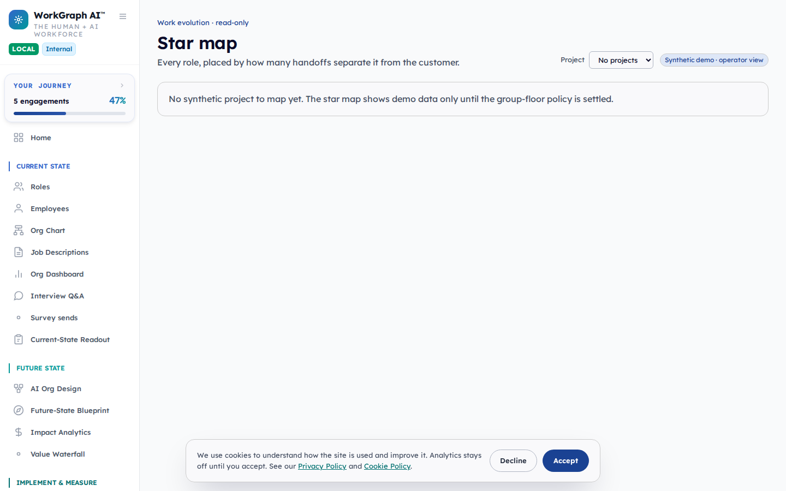
2. **[3] No demo engagement has any transcripts, process flows or data sources.** Engagement-sidebar steps 6–9, work-map steps 5–7. Page `/dashboard/work-evolution/transcripts`. Marcus tried Acme, Northwind, Meridian and Corvane. The page is mostly an upload form. **Cause:** the database has 0 `MeetingTranscript`, 0 `ProcessFlow` and 0 `DataSource` rows. Only `scripts/work-evolution/feed-demo.ts` writes them, and it makes a sixth organization, "Caliber-shaped feed demo (synthetic)", from a Caliber-shaped fixture. I did not run it: the walk's rule is the five demo profiles only, and the name is Caliber's (decision D-1).
   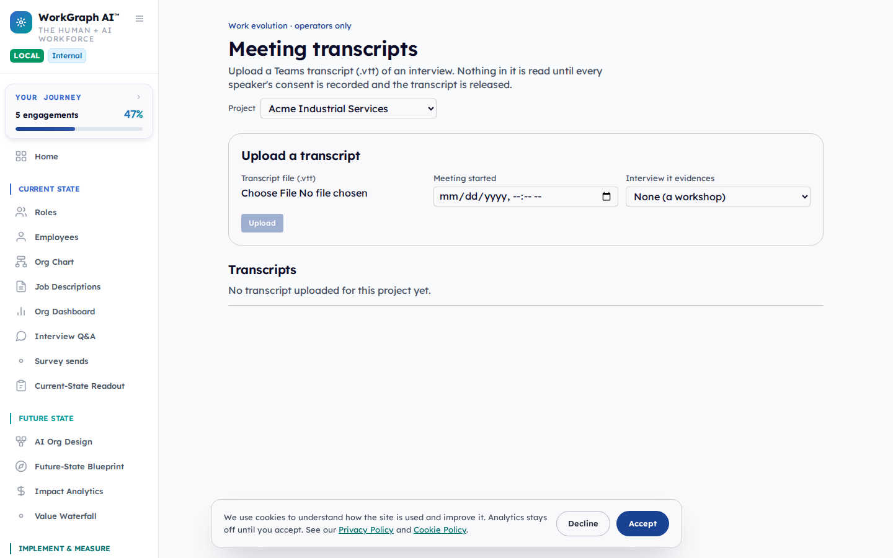
3. **[3] Workflows is an authoring tool with nothing in it.** Engagement-sidebar steps 11–13, work-map steps 12–14. Page `/dashboard/work-evolution/workflows`, also reached from a project card (`/dashboard/projects/<id>/workflows`). "0 named workflows", a "Start from" picker and a Save workflow button. The page doesn't name the client it belongs to and has no client picker. There is no evolution timeline. **Expected:** a project's workflows read as that client's process flows, titled with the client, with authoring one step further in.
   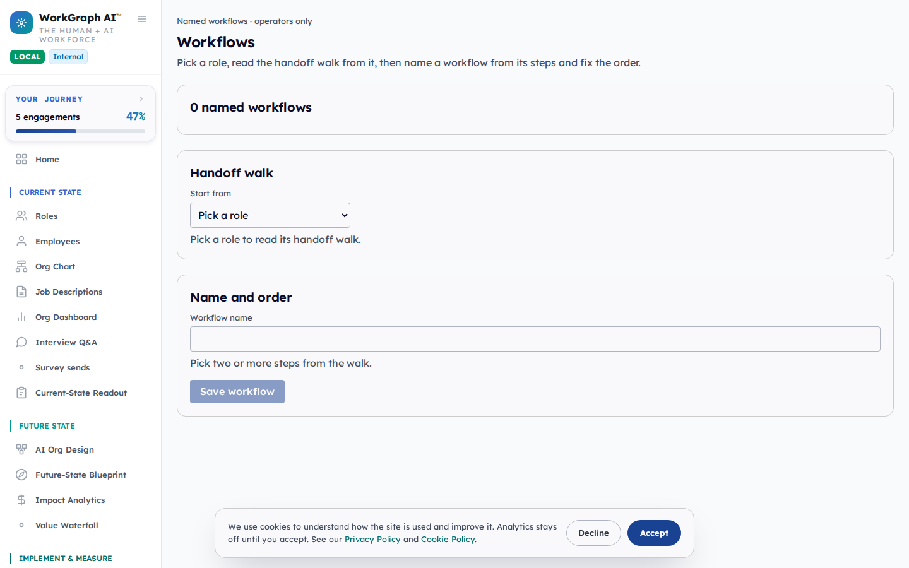
4. **[3] A role's Evolution tab is still hidden when the role is opened from the Roles list** (walk 1 finding 3, still there). People walk, steps 4–12: Marcus opened the Chief Technology Officer and scrolled down and up nine times, looking for a timeline. Engagement-sidebar walk, steps 14–15: the same. Re-checked outside the walk (`probes/role.txt`): opened from the Roles list, the page lands at `scrollY` 68 with the Evolution tab at y = −48, off the top of the screen. A direct load puts it at y = 20. The tab works, and its page is good (`/dashboard/roles/<id>/evolution`). **Expected:** role pages open at the top, or the tab row stays on screen.
   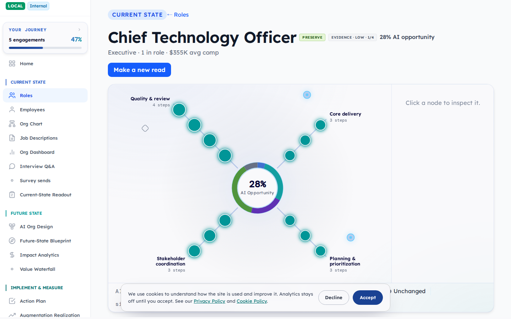
   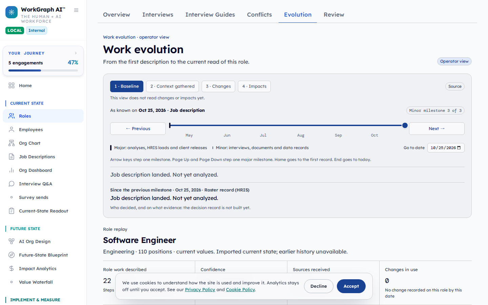
5. **[3] The Readout still says nothing about readiness, and its numbers still differ from the Roles page** (walk 1 finding 5, still there). People walk, step 17. For Meridian Financial Technologies the Readout shows **23** roles analyzed and **$15.2M** expected value a year. Roles shows **43** roles, and Engagements says "43 of 43 roles analyzed", **$16.8M**. There is no Draft or Ready label. With demo data, the figures can now be shown. *Caveat as in walk 1: "completed Role Profiles" and "roles analyzed" may count different things; if so, the page should say so.*
   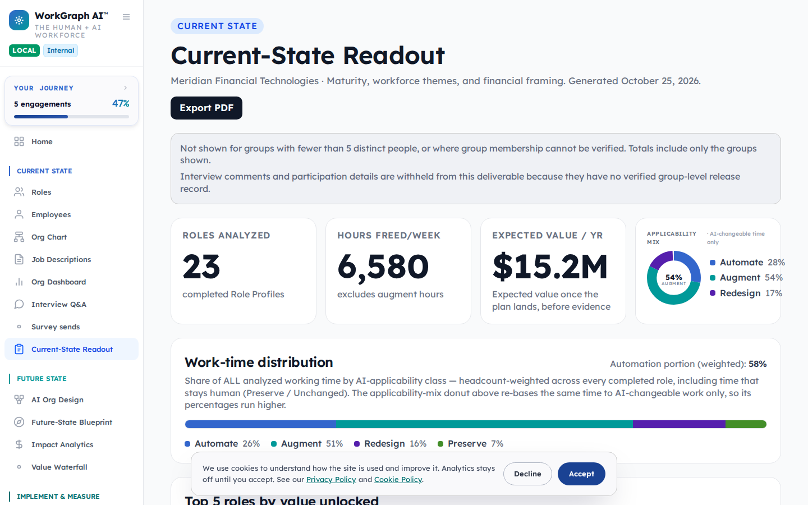
6. **[3] Every seeded interview is "submitted" with 0 answers.** Work-map walk, steps 8–10. Marcus used Interview Q&A as his stand-in transcript and opened the CEO's self assessment: "Interview submitted… Responses (0 answered)", every answer "-". All 206 seeded interviews have empty responses. **Cause:** the demo seed builds answers from the core question library (`scripts/seed-core-questions.ts`) and the role baselines. This walk loaded neither, because the rule was "the demo profiles only", and the seed gave no warning. This may be a setup gap, not a product bug (decision D-2). The seed should still refuse, or warn, when the library is empty.
   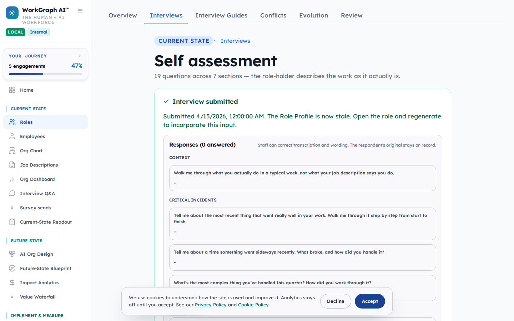
7. **[3] Role pages still carry a Send invite button for every role-holder and manager** (walk 1 finding 6, still there). People walk, step 5, Chief Technology Officer: "Send invite" per person, "Invite all role-holders" and "Invite all managers", next to "Generate" and "Upload". Here the role has one holder; on a large role it is the wall walk 1 saw. **Expected:** one "Invite role-holders" action with a confirmation.
   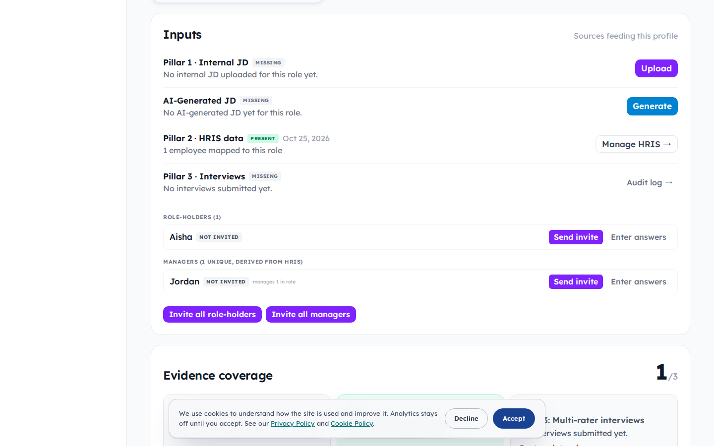
8. **[3] Platform pages still fail automated accessibility checks** (walk 1 finding 14, partly there). The Inspection, 16 pages, desktop and phone. Colour contrast fails on every page. Roles still has a critical `select-name` and `button-name`. `scrollable-region-focusable` remains on Roles and a role page. Org Chart's `select-name` and Interview Q&A's scrollable region no longer fail (not re-inspected on Org Chart, which no Walker opened this time).

### Severity 2

9. **[2] The Work Evolution group is below the fold of the sidebar.** Engagement-sidebar step 2, work-map step 1: both walks scrolled the sidebar before they saw it. At 1440 × 900 the group starts under Implement & Measure and Clients & Snapshots, after 18 other items.
   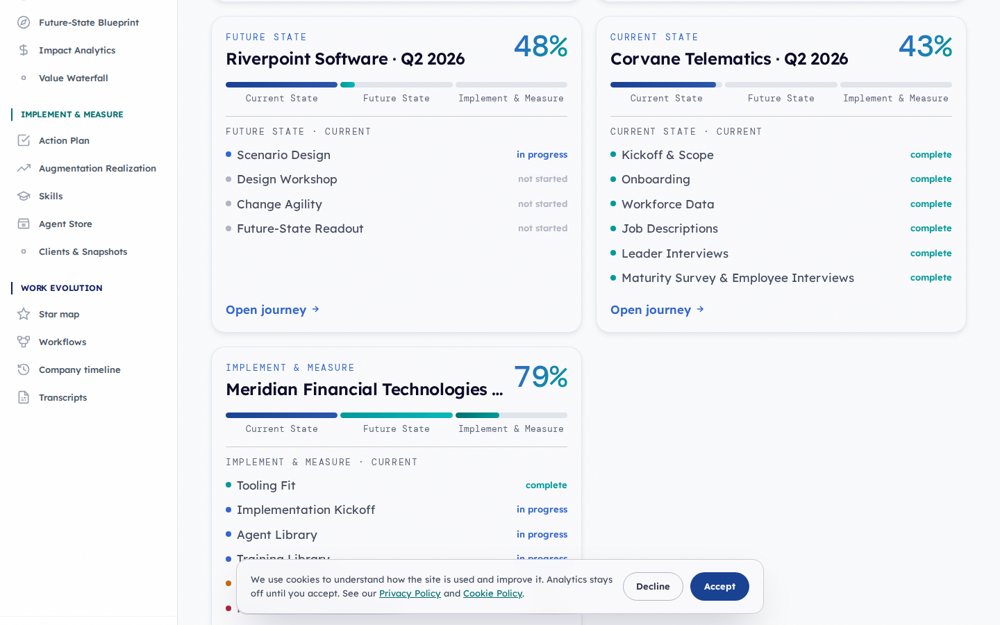
   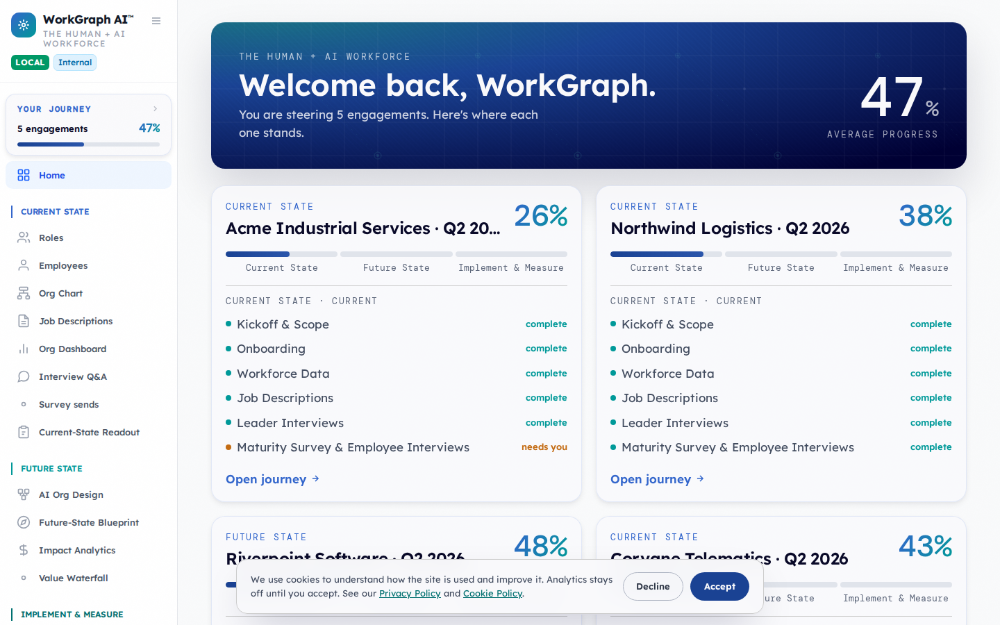
10. **[2] The Project picker on Transcripts quietly switches the active engagement everywhere.** Engagement-sidebar steps 7–9. Choosing a client there changed the engagement on the other pages, without saying so. In a client call, the next page shown would be a different client's.
11. **[2] The Roles list is still buried under HRIS data and summary tiles** (walk 1 finding 16, still there). People walk, steps 1–3. The roles start below the HRIS card, a loading block, four tiles and four filter rows. Delete buttons appear on hover.
    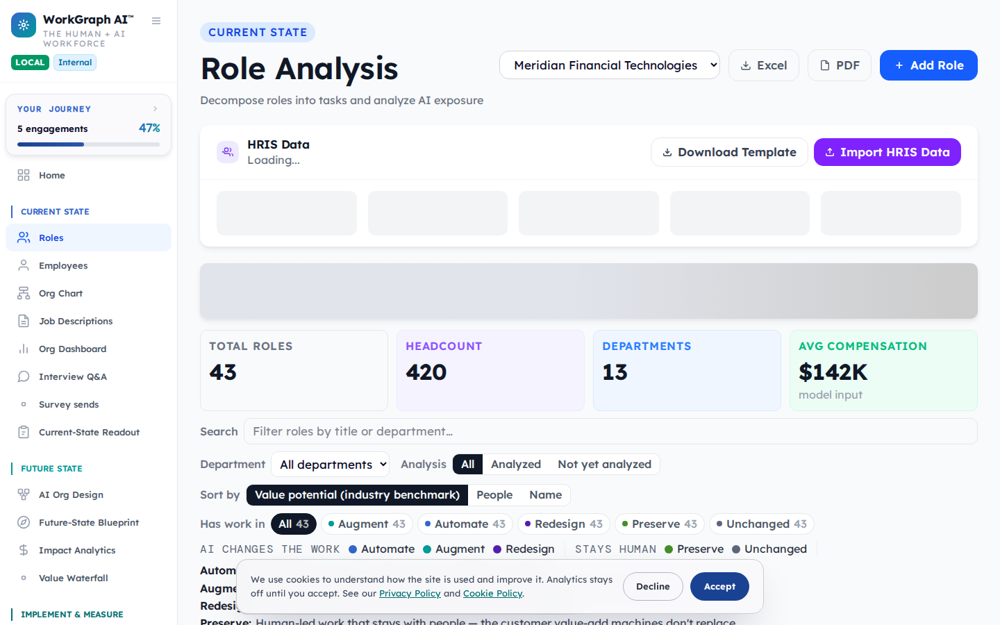
12. **[2] "Clients & Snapshots" still opens a page titled "Engagements"** (walk 1 finding 18, partly fixed). Each card now has Workflows and Company timeline links. The cards themselves still don't open a client, and the sidebar and the page use different names.
    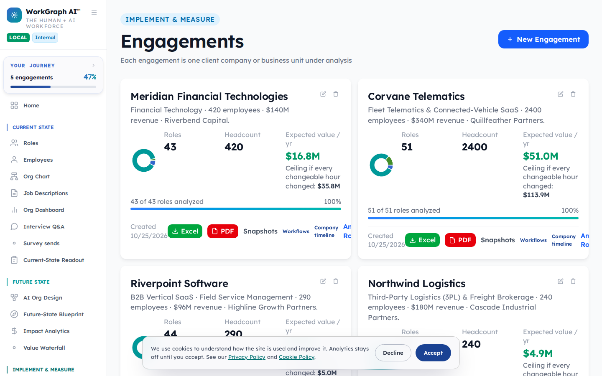
13. **[2] The way into an interview is a link called "Correct transcription and wording →"** (work-map step 10), and the page still carries internal tags. Walk 1 finding 17's "FS" and "arc closer fired" are still in the page's code (`dashboard/roles/[roleId]/interviews/[interviewId]/page.tsx`). They didn't show here only because the seeded interviews have no answers.
14. **[2] The cookie banner covers the bottom of every platform page** for the whole session (walk 1 finding 19, still there). It's in every screenshot above.
15. **[2] Roles still shifts while loading** (walk 1 finding 15, partly fixed). Fresh-load cumulative layout shift is **0.251** on Roles (threshold 0.25). It is now 0.009 on Interview Q&A (was 0.260) and 0.009 on a role page (was 0.298). Dashboard 0.044, Company timeline 0.009 (`probes/misc.txt`; local, no proxy, about 1–1.5 s to network idle).

### Worth keeping (severity 0)

- **Company timeline and Role replay work.** Work-map step 16 and people steps 13–15. The company timeline for Meridian shows real (demo) change across time, and Role replay for Software Engineer was the one role evolution timeline Marcus found. 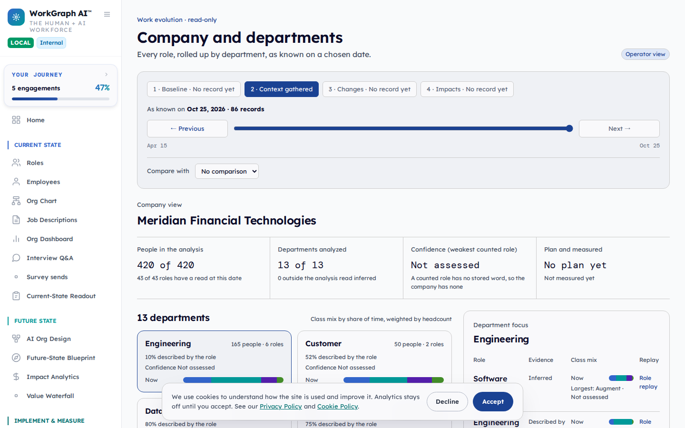
- **The new sidebar entries and card links are one click each** and named in plain words: Star map, Workflows, Company timeline, Transcripts.
- **Survey sends still answers "what has been sent" at a glance**, and says nothing goes out until release (people step 16).
- **Demo accounts make the walk showable.** No gray bars: every figure the findings talk about can be shown.

## Walk 1 vs walk 2, finding by finding

Walk 1's team findings, re-checked on this build. Walk 1 ran on the shared dev site with a real client's data. Walk 2 runs on `dev` at `e073d441` with demo data, so "still there" means the same behaviour on the newer code.

| Walk 1 | What it was | Walk 2 | Evidence |
|---|---|---|---|
| F1 [4] | No star map, transcripts or Workflows in the sidebar | **fixed** (navigation, with the flag on); the pages behind it are empty on demo data: new findings 1–3, 9 | `probes/nav.txt`; shots 01–05 |
| F3 [3] | Role Evolution tab hidden when opened from the Roles list | **still there**: scrollY 68, tab at y = −48 | finding 4; `probes/role.txt`; shot 06 |
| F4 [3] | "Open constellation" on Org Chart opens a role profile | **still there** in the code (`org-chart/page.tsx`, the label still links to the role page); not walked this time | source only |
| F5 [3] | Readout has no readiness label; numbers differ from Roles | **still there** (23 vs 43 roles, $15.2M vs $16.8M) | finding 5; shot 11 |
| F6 [3] | A Send invite button for every role-holder | **still there** | finding 7; shot 13 |
| F7 [3] | Interview status on a role page doesn't match Survey sends | **not comparable**: the seed marks interviews submitted without invitations | finding 6 |
| F14 [3] | Platform pages fail axe | **still there**, partly (contrast everywhere; Roles critical) | finding 8; `inspection/results.json` |
| F15 [2] | Pages shift while loading (Roles, Interview Q&A, role page) | **partly fixed**: Roles 0.251 still over; the other two 0.009 | finding 15; `probes/misc.txt` |
| F16 [2] | Roles list buried | **still there** | finding 11; shot 07 |
| F17 [2] | Interview page uses internal tags, never says transcript | **still there** in the code; hidden here by empty answers | finding 13 |
| F18 [2] | Clients & Snapshots opens "Engagements"; cards don't open a client | **partly fixed**: cards link to Workflows and Company timeline | finding 12; shot 10 |
| F19 [2] | Cookie banner on every platform page | **still there** | finding 14 |
| F2, F8–F13, F20–F29 | Public site and /baseline | **not re-walked**: out of this walk's scope | — |
| — | Star map empty for every demo engagement | **new** | finding 1 |
| — | No transcripts, process flows or data sources in demo data | **new** | finding 2 |
| — | Workflows is an empty builder with no client named | **new** | finding 3 |
| — | Seeded interviews submitted with 0 answers | **new** (setup; D-2) | finding 6 |
| — | Work Evolution group below the sidebar fold | **new** | finding 9 |
| — | Transcripts' Project picker switches the active engagement | **new** | finding 10 |
| — | Company timeline and Role replay work | **new**, worth keeping | shot 09 |

In short: 1 fixed, 3 partly fixed, 7 still there (2 of them by code only), 1 not comparable, 6 new problems and 1 new good thing.

## The Inspection

A separate process with no shared context (`harness/inspect.mjs`). For every page a walk reached, it opened a fresh browser with the demo session and aborted every non-GET request. It ran axe-core 4 against WCAG 2.0–2.2 A and AA at every impact level, plus landmark, heading, unnamed-control and first-twelve-Tab checks. Desktop (1440) and phone (390). 16 pages, 32 checks, 0 bounced to sign-in, 0 errors. Results are in `inspection/results.json`.

| | Platform pages (16) |
|---|---|
| axe violations | colour contrast (serious) on all 32 checks; critical `select-name` and `button-name` on Roles (both widths); serious `scrollable-region-focusable` on Roles and a role page (both widths) |
| One `h1` and a `main` landmark | every page |
| Focus visible on the first 12 Tabs | yes |
| Skip link | none |

## What got in MSW's way (for plan B)

1. **The Dead Parrot check still fails on every multi-page walk** (`alive: false`: "page … has 1 screenshot", "no instrument record"). All three walks are sealed and verified, but none is "alive". It's the same failure as walk 1. Plan B Task 6.
2. **Tool noise is still counted as instrument records.** 217 `requestfailed` records (Next.js prefetches aborted on navigation, and the analytics pings the read-only mode aborts). None became a finding. Plan B Tasks 3–4. The walk's vitals produced no "slow or unstable" finding this time (local server, no proxy), so walk 1's item 11 didn't show.
3. **Walker screenshots of a scrolled page can be blank.** The platform scrolls its main pane, not the window. After a few "scroll down" moves, several Walker screenshots show the sidebar and an empty pane. The report uses harness captures of the same pages from the top for findings 1–3, 5, 6 and 12. A screenshot should capture the element that scrolled.
4. **A build without the feature flags looks like a product bug.** The first pass ran on a build without `NEXT_PUBLIC_WORK_EVOLUTION_ENABLED` and `TEAMS_TRANSCRIPTS_ENABLED`. There, the Work Evolution group was missing and its pages returned 404. I stopped that pass, kept it in `pass-0-flags-off/`, rebuilt with the flags and re-ran all three walks. A walk's `run.json` should record the app's flags.
5. **"Scroll up" is still relative, and there is no Home key.** It's the same as walk 1, item 9. On the CTO page the people walk scrolled down five times and up three, and never got back to the tab row. The page's scroll offset is the finding (4), but a person would press Home.
6. **No skills and no `msw report`.** The walk prompts, the Inspection, the probes and this report are hand-made stand-ins (`harness/`). `harness/md2html.py` turns this file into `REPORT.html`.

## How this was run

- **App:** WorkGraph AI `dev` at `e073d441`, copied into `app/` by the host (a private repo; never committed, deleted after the walk). `npm ci`. `next build` was run with `env -u DATABASE_URL -u DATABASE_URL_UNPOOLED -u NODE_ENV`. `next start` ran on `127.0.0.1:3000`, with the Work Evolution and Teams-transcripts flags on (`harness/app-env.sh`, which holds only the local database URL and a random local JWT secret).
- **Database:** `embedded-postgres` 17.6.0-beta.15, npm-installed in `pg/` (never in the app's dependencies). The app's migrations need `pgvector`, which the embedded package lacks. I built pgvector 0.8.1 from GitHub sources against PostgreSQL 17.6 headers built from source. The schema came from the repo's 59 Prisma migrations (`prisma migrate deploy`).
- **Seed:** `scripts/seed-demo.mjs` five times, once per profile: acme, northwind, riverpoint, corvane, merfintech. I didn't use `all`, which also runs a Caliber profile. The target guard allowed only localhost. I did not load the core question library, the role baselines or `feed-demo.ts`; see D-1 and D-2.
- **Org check before any Walker** (`orgcheck.mjs`, output in `ORG-CHECK.txt`): five organizations, every one a demo profile; four PE firms, all demo; every user `@workgraph.local`. PASS.
- **Sign-in:** `harness/signin.mjs` signs in once as `demo@workgraph.local` through the app's own `/login` form, the same path as the repo's e2e precheck. It reads the demo password from the demo profile at run time and never writes it down. The session went to `harness/demo-session.json`, which was used only as each journey's `storage_state` and was deleted after the walk. The Walkers never typed a password.
- **Walk server:** msw `dev` plus walk 1's two fixes (`/wt/msw/msw-mfx-msw-wg-team-walk-1/server`, Playwright 1.63.0, Chromium build 1243, Node 20.20.2). Each walk ran as one `claude -p` session with only the msw tools (`harness/walk.sh`). The run file `run.json` records a test environment with seeded data, read-only and no masking. Walkers are in `walkers/`, journeys in `journeys/`.
- **Probes outside MSW** (`harness/probe-*.mjs`, outputs in `probes/`): GET only, localhost only.
- The raw walks, narrations and harness logs are in this folder and hold only demo data.
- **Cleanup:** after the walk I stopped the app and Postgres. Then I deleted the `app/` folder (the private source), the whole `pg/` folder (the database data, the embedded Postgres and the pgvector build) and the demo session file. The org check was recorded once more just before that, at 22:08 UTC (evidence ev#2), and passed again.

## Decisions for Jimmy

```yaml decision
id: D-1
question: How should the demo profiles get Work Evolution data (star map, transcripts, process flows), given that today only feed-demo.ts writes it and it creates a "Caliber-shaped" sixth org?
options:
  - seed it into the five demo profiles — mark demo projects as synthetic for the star map and give each profile a few transcripts and process flows
  - rename and allow feed-demo — make its org a sixth fake profile with no Caliber name or shape, and let demo walks run it
  - leave it — accept that demo accounts can't show Work Evolution
recommended: seed it into the five demo profiles
rationale: [Likely] The star map lists only isSynthetic projects and the demo seed sets isSynthetic false, so no demo account can show the pages PR #387 just put in the sidebar; seeding the existing profiles keeps the five-org rule and needs no Caliber-shaped data.
evidence:
  - REPORT.md findings 1-3
  - shots/03-star-map-empty.png
  - shots/04-transcripts-empty.png
disposition: none
private: false
```

```yaml decision
id: D-2
question: May demo walks also load the reference libraries (core questions, role baselines), which hold no org or person data, so seeded interviews have answers?
options:
  - allow the reference libraries — run seed-core-questions and the baseline seed before the demo profiles
  - keep demo profiles only — and make the demo seed warn or refuse when the library is empty
recommended: allow the reference libraries
rationale: [Likely] All 206 seeded interviews came out submitted with 0 answers because the library wasn't loaded; the libraries are product content, not client data, and the walk loses the interview and transcript stand-ins without them.
evidence:
  - REPORT.md finding 6
  - shots/12-interview-no-answers.png
disposition: none
private: false
```

```yaml decision
id: D-3
question: Are NEXT_PUBLIC_WORK_EVOLUTION_ENABLED and TEAMS_TRANSCRIPTS_ENABLED on for the dev and production deployments?
options:
  - check and turn them on where the team uses the platform
  - keep them off in production for now — and say so in the PR #387 notes
recommended: check and turn them on where the team uses the platform
rationale: [Certain] Without the flags the Work Evolution sidebar group is missing and its pages return 404 (pass-0-flags-off); the PR #387 fix only reaches Marcus where the flag is on. This walk couldn't see the deployments' settings.
evidence:
  - REPORT.md "Did each Walker reach their goal?" (the PR #387 check)
  - pass-0-flags-off/walks
disposition: none
private: false
```

```yaml decision
id: D-4
question: Should the next nav lane open role pages at the top (or keep the role tab row on screen) and move the Work Evolution group above the fold?
options:
  - one small nav lane — role pages scroll to top on open, Work Evolution moves up the sidebar, Transcripts' picker says it switches the engagement
  - leave it — the routes exist now
recommended: one small nav lane
rationale: [Likely] Walk 1's role-tab finding is unchanged two days later, and both new journeys had to scroll the sidebar to find the group PR #387 added.
evidence:
  - REPORT.md findings 4, 9 and 10
  - probes/role.txt
  - shots/02-work-evolution-below-fold.png
disposition: none
private: false
```
